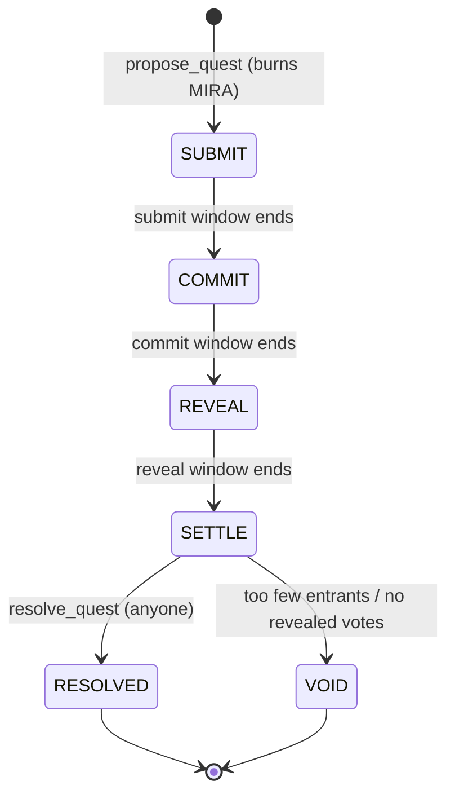

# MIRA — the memecoin that is alive

[](https://github.com/daodudestiny56-netizen/near-memcoin/actions/workflows/ci.yml)


**MIRA is a NEP-141 memecoin whose supply reacts to community activity.** People stake MIRA to enter quests, vote in secret, and watch failed stakes burn on-chain. When the community shows up, MIRA *thrives* and burns harder. When nobody shows up, MIRA *starves*, and anyone can feed it by taxing holders who have gone idle.

> Built for the NEAR Hackathon, track **Memecoins With Mechanics** ("judged on the mechanic, not the chart").

| | |
|---|---|
| **Live app** | [mira-memecoin.vercel.app](https://mira-memecoin.vercel.app) (reads the testnet contract live) |
| **Contract (testnet)** | [`mira-memecoin.testnet`](https://testnet.nearblocks.io/address/mira-memecoin.testnet) |
| **Owner / treasury** | [`mira-treasury.testnet`](https://testnet.nearblocks.io/address/mira-treasury.testnet) |
| **Token** | NEP-141, symbol `MIRA`, 18 decimals, 10,000,000 minted once, never again |
| **Source** | this repository (contract, web app, scripts, CI) |
| **Tested wasm** | [`contract/wasm/mira.wasm`](contract/wasm/mira.wasm), built and sandbox-tested by CI from this source |

---

## Contents

1. [The idea in one minute](#1-the-idea-in-one-minute)
2. [What is real and what is not](#2-what-is-real-and-what-is-not)
3. [The mechanics, in full](#3-the-mechanics-in-full)
4. [A real quest, with real numbers](#4-a-real-quest-with-real-numbers)
5. [Token and trust model](#5-token-and-trust-model)
6. [Contract API](#6-contract-api)
7. [Architecture](#7-architecture)
8. [Testing and CI](#8-testing-and-ci)
9. [The web app](#9-the-web-app)
10. [Run it yourself](#10-run-it-yourself)
11. [The testnet deployment](#11-the-testnet-deployment)
12. [Known limitations](#12-known-limitations)
13. [Roadmap](#13-roadmap)
14. [Repository layout](#14-repository-layout)
15. [Related project](#15-related-project)

---

## 1. The idea in one minute

Most memecoins are a ticker. MIRA is a small game whose rules move the supply.

1. **Quests.** A quest is a challenge with a prize pool. Players **stake** MIRA to enter and post **proof** (a link or note).
2. **Secret voting.** Holders **stake to vote** on entries. Votes are hashed (*commit*), then opened later (*reveal*), so nobody can copy the crowd or be swayed by the running tally.
3. **Settlement.** The top third of entries win the pool plus their stake back. Everyone else's stake is **burned, rolled into the next quest, or paid to the voters who backed a winner.**
4. **The heartbeat.** Every join, vote, gm and settlement is a "beat". The number of beats in an epoch sets MIRA's **mood**, and the mood sets how hard failed stakes burn.
5. **Starvation.** If a whole epoch is quiet, MIRA starves. Anyone can then tax long-idle holders 1%: 80% feeds the next quest pool, 20% pays the keeper.

The supply therefore breathes with the community instead of sitting still. Every burn, payout and tax is emitted as an event and appears in the app's live feed.

---

## 2. What is real and what is not

The README is written so it can be checked against the code.

| Claim | Status |
|---|---|
| The contract is deployed on NEAR testnet at `mira-memecoin.testnet` | **Real.** Verifiable with the views in [section 11](#11-the-testnet-deployment). |
| A full quest has been played on that contract | **Real.** Quest #1 ran propose → join → sealed votes → reveal → settle with five funded testnet accounts ([section 4](#4-a-real-quest-with-real-numbers)). |
| 53 unit tests of the game rules pass | **Real.** `cd contract && npm test`, run in CI on every push. |
| The real wasm passes an integration test on a local NEAR chain | **Real.** 5 sandbox tests in CI ([section 8](#8-testing-and-ci)). |
| The web app reads live data from the contract | **Real.** One `get_dashboard` view call every 5 s over plain JSON-RPC, with exponential backoff if the RPC throttles. |
| The web app can sign transactions with a wallet | **Implemented, not end-to-end exercised.** Signing goes through `@hot-labs/near-connect`. I drove the contract's calls from scripts with keypairs; I did not click through a wallet popup myself. |
| The faucet (`claim`) | **Demo only.** It pays 1,000 test MIRA once per account from the owner's balance. Switch it off with `set_faucet`. |
| Mainnet | **Not deployed.** The contract is unaudited ([section 12](#12-known-limitations)). |

---

## 3. The mechanics, in full

### 3.1 Epochs, pulse and mood

Time is cut into **epochs** (`epoch_s`, 900 s on the testnet deployment, 86,400 s by default). Each state-changing action adds a beat to the current epoch's **pulse**:

| Action | Beats |
|---|---|
| `gm` | 1 |
| `propose_quest` | 1 |
| `join_quest` | 1 |
| `commit_vote` | 1 |
| `reveal_vote` | 1 |
| `resolve_quest` | 1 |

When an epoch ends, its pulse is compared with `target_pulse` and sets the mood used for the next epoch:

| Mood | Rule (pulse vs target `T`) |
|---|---|
| **THRIVING** | pulse ≥ 1.5 × T |
| **STEADY** | T ≤ pulse < 1.5 × T |
| **HUNGRY** | 0.5 × T ≤ pulse < T |
| **STARVING** | pulse < 0.5 × T, **or** any silent epoch in between |

The clock is **lazy**: nothing runs on a timer. The first call after a boundary settles the finished epochs, and an epoch with no activity at all counts as pulse 0 (STARVING). View calls compute the live mood without writing state, so the dashboard is always current.

### 3.2 Where a failed stake goes

Every entrant who does not win loses their stake. That pool of failed stakes is split by the mood at settlement. The splits are **constants in the source code** (`contract/src/core/constants.js`). Nobody, including the owner, can change them after deploy.

| Mood | Burned | Next quest pool | Correct voters |
|---|---|---|---|
| THRIVING | 60% | 20% | 20% |
| STEADY | 50% | 30% | 20% |
| HUNGRY | 35% | 45% | 20% |
| STARVING | 20% | 60% | 20% |

A healthy community burns harder (deflation as a reward for activity). A struggling one feeds the next quest instead, to win people back. Rounding dust always goes to the burn.

### 3.3 Quest lifecycle



* **Propose (burn-to-propose).** The proposer needs a gm streak of at least `propose_streak` and **burns `propose_burn` MIRA** (50 by default). They set the title, the entry stake, an optional seed for the pool, and the three phase lengths. The pool also inherits the whole **rollover** (failed stakes from earlier quests).
* **Enter.** Within the submit window a player stakes `stake` MIRA into contract escrow (one entry per account, up to 30 per quest) and posts a proof of up to 280 characters. Proof can be replaced until the window closes. No proof means no chance to win.
* **Vote (commit).** In the commit window any holder stakes a **vote stake** (`stake / 5`, minimum 1 MIRA) and submits `sha256("{questId}:{voter}:{entrant}:{salt}")`. Binding the voter into the hash means a copied hash cannot be revealed by anyone else.
* **Reveal.** In the reveal window each voter reveals entrant and salt. The contract checks the hash, rejects self-votes, and requires the entrant to have posted proof. Each vote adds **weight 1 + min(scars, 3)** to that entry.
* **Settle.** After the reveal window anyone can call `resolve_quest`.

### 3.4 Settlement rules

* **Winners.** Entries that have proof and at least one vote are ranked by weighted votes (ties go to the earlier joiner). The top `max(1, floor(entrants / 3))` win.
* **Winner payout.** Each winner gets their **stake back plus an equal share of the pool** (pool dust rolls over).
* **Losers.** Every other entrant, including anyone who never posted proof, forfeits their stake and earns a **scar**.
* **Voters.** A vote is *correct* if it was revealed and backed a winner. Correct voters get their vote stake back plus an equal share of the **voter pot**: the voter share of failed stakes **plus the stakes forfeited by wrong and unrevealed voters**. If there are no correct voters the pot is burned.
* **Void.** If a quest has fewer than 2 entrants, or no vote was revealed, it is **voided**: every stake is refunded and the pool rolls over. Nobody loses anything.
* **Conservation.** The contract's balance always equals escrow + pools + rollover. A test asserts this after every settlement path.

### 3.5 Rituals: gm and streaks

`gm` can be called once per epoch. Consecutive epochs build a **streak**; skipping an epoch resets it to 1 (the best streak is kept). A streak of `propose_streak` unlocks proposing quests. Each gm also earns XP and counts as a beat.

### 3.6 Scars

Losing a quest leaves a **scar** on the account. Scars are not tradable. Each scar (up to 3) adds +1 to the account's vote weight. Players who lose and keep playing gain a bit more say.

### 3.7 The starvation keeper

When the mood is STARVING, anyone may call `starve(account_id)` on a holder who:

* has been inactive for at least `starve_idle_epochs` (2) epochs,
* holds at least `starve_min` (10) MIRA,
* has not already been starved this epoch.

The contract takes `starve_bps` (1%) of the balance. **80% moves into the next quest pool and 20% goes to the caller** as a bounty. Active players, the treasury, the contract itself and any account the owner has exempted (for example a DEX pool) are never taxed. This is a deliberate holder cost: MIRA rewards showing up and taxes disappearing.

---

## 4. A real quest, with real numbers

This is quest **#1** on `mira-memecoin.testnet`, played by `scripts/seed.mjs`. Read it back yourself with `get_quest {"id": 1}`. The testnet contract has since been played further (more quests, both burn-heavy THRIVING and burn-light STARVING settlements), so overall totals have grown; quest #1 stays fixed.

| Step | What happened |
|---|---|
| Setup | `mira-ana`, `-bob`, `-cy`, `-dee`, `-eve` each claimed 1,000 test MIRA and said gm. |
| Propose | `mira-ana` burned **50 MIRA** and seeded the pool with **100 MIRA**. Entry stake 25, vote stake 5. |
| Enter | `bob`, `cy`, `dee` each staked 25 and posted proof. |
| Vote | `eve` and `ana` sealed votes (hashes only on-chain). |
| Reveal | Both revealed a vote for `bob`. |
| Settle | The coin was **HUNGRY** (35 / 45 / 20). |

The arithmetic, which the contract's result matches to the last digit:

* Winners: `floor(3 / 3) = 1`, so **bob** wins. He receives his 25 stake back plus the 100 pool: **125 MIRA**.
* Losers: `cy` and `dee` forfeit 25 each, so the failed pool is **50 MIRA**.
* Burned: 35% × 50 = **17.5 MIRA**. Rolled over: 45% × 50 = **22.5 MIRA**. Voter share: 20% × 50 = **10 MIRA**.
* Both voters were correct, so each gets 5 (their stake) + 5 (half of 10) = **10 MIRA**.
* On-chain result: `burned 17.5`, `rolled_over 22.5`, `voter_pot 10`, `correct_voters 2`, `mood HUNGRY`.
* Total burned on the contract after the seed run: 50 + 50 (two proposals) + 17.5 = **117.5 MIRA**.

---

## 5. Token and trust model

* **Standard.** NEP-141 (`ft_transfer`, `ft_transfer_call`, `ft_balance_of`, `ft_total_supply`, `ft_metadata`) with NEP-141 events, plus no-op NEP-145 storage methods so wallets and DEXs can register accounts without a deposit (the contract pays storage).
* **Supply.** 10,000,000 MIRA minted **once** at `init`, to the owner. There is no mint function. The only thing that changes supply is burning.
* **Burn sources.** Quest proposals (50 MIRA each) and the burn share of failed stakes.

What the **owner** can and cannot do:

| Can | Cannot |
|---|---|
| Tune clocks and thresholds (`set_config`): `epoch_s`, `target_pulse`, `min_phase_s`, `propose_streak`, `propose_burn`, `starve_bps`, `starve_min`, `starve_idle_epochs`, `claim_amount` | Mint tokens |
| Exempt an account from starvation (`set_exempt`) | Pause or freeze anything |
| Switch the demo faucet on or off (`set_faucet`) | Touch escrow, pools or rollover |
| | Change the burn / rollover / voter splits (constants in the code) |
| | Change winner rules, or settle a quest differently than the code says |

Note that the treasury account *does* hold the unissued supply, and the owner can move it like any holder. A production launch would put the treasury under a DAO or multisig.

---

## 6. Contract API

All amounts are decimal strings in base units (18 decimals). Account IDs are strings.

### Token (NEP-141 / NEP-145)

| Method | Type | Notes |
|---|---|---|
| `ft_transfer {receiver_id, amount, memo?}` | call | Requires exactly 1 yoctoNEAR. |
| `ft_transfer_call {receiver_id, amount, memo?, msg}` | call | 1 yoctoNEAR. If the receiver fails or returns unused tokens, they are refunded. |
| `ft_balance_of {account_id}` · `ft_total_supply` · `ft_metadata` | view | |
| `storage_deposit` · `storage_balance_of` · `storage_balance_bounds` | | No-ops: accounts need no registration. |

### Game

| Method | Who | What |
|---|---|---|
| `gm` | anyone | Once per epoch. Builds the streak. |
| `claim` | anyone | Demo faucet, once per account. |
| `propose_quest {title, description, stake, seed?, submit_s, commit_s, reveal_s}` | streak holder | Burns `propose_burn`, returns the quest id. |
| `join_quest {id}` | anyone | Stakes into escrow. |
| `submit_proof {id, proof}` | entrant | Until the submit window closes. |
| `commit_vote {id, commit}` | anyone | `commit` = lowercase hex SHA-256 of `"{id}:{voter}:{entrant}:{salt}"`. |
| `reveal_vote {id, entrant, salt}` | voter | In the reveal window. |
| `resolve_quest {id}` | anyone | After the reveal window. |
| `starve {account_id}` | anyone | Only while STARVING. |

### Owner

`set_config {config}` · `set_exempt {account_id, exempt}` · `set_faucet {on}`

### Views

`get_overview` (supply, burned, rollover, treasury, circulating, mood, pulse, history, current splits) · `get_config` · `get_dashboard {account_id?, quest_limit?, event_limit?, board_limit?}` (everything the page shows in one call) · `list_quests {from_id, limit}` (newest first) · `get_quest {id}` (entries and who has voted or revealed, never the choice) · `get_player {account_id}` · `get_leaderboard {limit}` · `recent_events {limit}`

---

## 7. Architecture

```
┌────────────────────────┐        one get_dashboard view / 5 s          ┌──────────────────────────┐
│  React + Vite web app  │ ───────────────────────────────────────▶ │  mira-memecoin.testnet   │
│  (src/)                │                                          │  near-sdk-js wrapper     │
│  @hot-labs/near-connect│ ── signed FunctionCall via wallet ─────▶ │  └─ src/core (game rules)│
└────────────────────────┘                                          └──────────────────────────┘
```

**Why the rules are separate from the contract.** `near-sdk-js` does not install on Windows ("Platform win32 is not supported"), so the whole game lives in plain ES modules under `contract/src/core/`. They talk to storage through a tiny `get / set / del` interface and take the host (`sha256`, `log`) as injected dependencies. That has three effects:

* The same code runs in Node (fast unit tests anywhere) and on-chain.
* `contract/src/contract.js` is only a thin shell: decorators, argument parsing, NEP-141 promises.
* CI on Linux compiles the shell with `near-sdk-js` and tests the real wasm.

| Module | Responsibility |
|---|---|
| `core/game.js` | Per-transaction context, typed storage helpers, the event ring buffer. |
| `core/token.js` | Balances, transfers, burns, `ft_transfer_call` refund math. |
| `core/heartbeat.js` | Epochs, pulse, mood (pure functions, view-safe). |
| `core/players.js` | Stats, gm streaks, scars, faucet, leaderboard. |
| `core/quests.js` | Propose, join, proof, quest listing. |
| `core/settle.js` | Commit, reveal, settlement and payout. |
| `core/starve.js` | The starvation keeper. |
| `core/views.js` | Read-only aggregates for the dashboard. |
| `core/admin.js` | Init and the owner's narrow powers. |
| `core/constants.js` | Splits, defaults, caps. |

**Storage layout.** Per-key records instead of one big blob: `m` (meta), `cfg`, `hb` (heartbeat), `b:{account}` (balance), `s:{account}` (stats), `q:{id}`, `qe:{id}:{account}` (entry), `qv:{id}:{account}` (vote), `ev:{n}` (event ring of the last 100). Amounts are stored as BigInt-safe JSON.

---

## 8. Testing and CI

**53 unit tests** (`cd contract && npm test`, Node's built-in runner) cover the rules:

* token: supply, overdrafts, burn accounting, `ft_transfer_call` refund math
* heartbeat: thresholds, epoch rollover, silent-epoch starvation, view-without-write
* players: streaks, resets, once-per-epoch, faucet, leaderboard
* quests: propose, escrow, seeds and rollover inheritance, validation, deadlines
* settlement: happy path, wrong and unrevealed voters, void paths, copied commits, self-votes, double settlement, mood-dependent splits, and an **escrow conservation** check after each path
* starvation: eligibility, once-per-epoch, exemptions, dust, owner-only controls

**5 sandbox tests** (`npm run test:sandbox`, near-workspaces) deploy the built `mira.wasm` to a local NEAR chain and exercise the real contract: NEP-141 metadata and supply, the 1-yocto requirement, a failing `ft_transfer_call` that refunds everything, the faucet, and an entire quest through to the burn.

**CI** (`.github/workflows/ci.yml`) runs two jobs on every push. The *contract* job runs unit tests → builds the wasm → runs the sandbox tests → commits the tested wasm to `contract/wasm/`. The *web* job installs, lints, type-checks and builds the app.

**Bugs the tests caught (and I fixed).** These are in the git history:

* *Views read the caller.* NEAR forbids `predecessor_account_id` and `attached_deposit` inside view calls. Every view would have failed on-chain while every unit test passed. The sandbox test found it.
* *Imports shadowing methods.* `near-sdk-js` hoists each method to a top-level function, so imports named `init`, `gm`, `claim` and `starve` produced "Duplicate declaration". CI's build step found it.
* *A stale UI under rate limiting.* While filming the demo, the page was making ~13 RPC calls per refresh and the public RPC throttled it, so the screen lagged the chain. Fixed with the single `get_dashboard` view, polling backoff, and a sandbox assertion on that view. The deprecated `rpc.testnet.near.org` (it now answers 429 on purpose) was removed from the app and scripts at the same time.
* *`list_quests` returned the oldest quests*, not the newest, once there were more than one page. A unit test now covers it.

---

## 9. The web app

React 19 + TypeScript + Vite, Bricolage Grotesque, no UI library.

* **Hero.** A mascot whose *face is the contract's mood*: its expression changes, and it breathes faster as the pulse approaches the target. Live supply, burned, circulating, rollover pool and a countdown to the next heartbeat.
* **Vitals.** A heartbeat chart of pulse per epoch against the target, and a bar showing exactly where a failed stake goes under the current mood. A **mood picker** previews all four moods (mascot face, effect, burn / rollover / voter split) without touching the chain; it is labelled as a preview.
* **Quests.** Cards with a four-step timeline and a per-phase action: enter, proof, sealed vote (the salt stays in this browser's local storage), reveal, settle. A burn-to-propose dialog.
* **Rituals.** gm with a streak counter, scars, the faucet, and the starvation keeper.
* **Live feed**, **leaderboard**, and an honest "how it works / limits" section.

Data flow: `src/chain/rpc.ts` calls the contract's views over JSON-RPC (two FastNEAR endpoints, tried in turn); `src/state/mira.tsx` polls `get_dashboard` once every 5 s (doubling the wait up to 8x after a throttled response) and holds state; transactions go through `src/chain/wallet.ts`. A `VITE_MOCK=1` fake chain exists for UI development only and is not bundled into production builds.

---

## 10. Run it yourself

Requirements: Node 20+ (22+ for the web app build).

```bash
# web app against the live testnet contract
npm install
npm run dev            # http://localhost:5173
npm run build && npm run lint

# unit tests for the game rules (any OS)
cd contract && npm install --ignore-scripts && npm test
```

`npm install` inside `contract/` runs a `near-sdk-js` post-install that fails on Windows; use `--ignore-scripts` there. Building the wasm and running sandbox tests needs Linux (or WSL), which is what CI does:

```bash
cd contract && npm install && npm run build && npm run test:sandbox
```

### Recording the demo (and why there is a test signer)

A headless browser cannot operate a wallet popup, so the demo is filmed with a **recording-only signer**:
`VITE_DEMO_SIGNER=1` makes the page hand each transaction to a harness (`scripts/demo/record.mjs`) that signs it in Node with throwaway testnet keys. The harness drives the *real* UI (visible cursor, real clicks and typing), and every action is a real testnet transaction. The checks are literal `import.meta.env` comparisons, so normal and production builds contain none of this code (the live bundle was checked for it).

```bash
VITE_DEMO_SIGNER=1 npx vite build --outDir dist-demo
npx vite preview --outDir dist-demo --port 5200 &
cd scripts/demo && npm install && node record.mjs out/   # needs the demo accounts' keys in ~/.near-credentials
```

Environment variables (`.env`): `VITE_MIRA_CONTRACT` (contract account), `VITE_NEAR_NETWORK` (`testnet` | `mainnet`), `VITE_NEAR_RPC` (comma-separated RPC URLs), `VITE_MOCK=1` (UI development only).

---

## 11. The testnet deployment

Deployed with `scripts/deploy.mjs` from the CI-tested wasm (566 KB). Initialised with demo clocks:

```json
{ "owner_id": "mira-treasury.testnet", "faucet_on": true,
  "config": { "epoch_s": 900, "target_pulse": 10, "min_phase_s": 20, "propose_streak": 1 } }
```

Verify it yourself without any tooling (replace the method and args as needed):

```bash
curl -s https://rpc.testnet.fastnear.com -H 'content-type: application/json' -d '{
  "jsonrpc":"2.0","id":1,"method":"query","params":{
    "request_type":"call_function","finality":"final",
    "account_id":"mira-memecoin.testnet","method_name":"get_overview",
    "args_base64":"e30="}}'
# the result is a byte array of JSON; decode it, or use the web app / near-cli
```

Scripts (in `scripts/`, own `package.json` with `near-api-js`):

| Script | Purpose |
|---|---|
| `create-testnet-account.mjs` | Create a faucet-funded testnet account. Keys are written to `~/.near-credentials/`, never to the repo. |
| `deploy.mjs` | Check storage cost, deploy `contract/wasm/mira.wasm`, initialise, verify. |
| `seed.mjs` | Play a full quest with five accounts, then leave a second quest open. |

---

## 12. Known limitations

Hackathon software, stated plainly:

* **Unaudited, testnet only.** Do not put real value in it.
* **Sybil votes.** One account is one vote (plus scar weight). Someone with many funded accounts can sway a quest. Stakes make it expensive, not impossible. Mitigations on the roadmap: stake-weighted or reputation-gated voting.
* **Collusion between voters and entrants** is not prevented beyond the self-vote rule.
* **Entry and voter caps** (30 entrants, 60 voters per quest) keep settlement inside the gas limit of a JS contract.
* **Free actions cost the contract storage.** The contract pays storage for stats and entries, so a spammer could burn its storage balance. A production version needs a storage deposit or a fee.
* **`near-sdk-js` is unmaintained** (last release June 2024) and NEAR's docs call `near-sdk-rs` the only official SDK. JS contracts also use more gas than Rust. The rules are isolated in `src/core` precisely so they can be ported.
* **Wallet signing is not end-to-end verified** in a browser by the author (see [section 2](#2-what-is-real-and-what-is-not)). Reads and all contract calls are verified.
* **`ft_transfer_call` is tested against a failing receiver**, not a real DEX receiver.
* **The starvation tax is a real cost to idle holders**, by design. Exempt DEX pools and treasuries with `set_exempt`.
* **The leaderboard indexes the first 1,000 players** and sorts on read, and `get_dashboard` includes it, so a very large player base would need an indexer or a capped top-N stored on write.
* **Free public RPCs throttle.** The app backs off, but heavy traffic needs a dedicated RPC key (`VITE_NEAR_RPC`).
* **Timing uses the block timestamp**, which is set by validators within a small tolerance.
* **Local vote salts.** A sealed vote can only be revealed from the browser that sealed it unless the user saved the salt.

---

## 13. Roadmap

* Port `src/core` to `near-sdk-rs`, keeping the test vectors.
* Stake-weighted or reputation-gated voting to harden against sybils.
* Treasury under a DAO (Sputnik) instead of an EOA.
* NEAR Intents integration so MIRA can be swapped and bridged.
* Automated keepers for `resolve_quest` and `starve`.
* Mainnet launch after an audit.

---

## 14. Repository layout

```
.
├── contract/
│   ├── src/core/          game rules (plain ES modules, unit-tested)
│   ├── src/contract.js    near-sdk-js wrapper: NEP-141 + game methods
│   ├── test/              53 unit tests
│   ├── sandbox/           5 integration tests against the real wasm
│   └── wasm/mira.wasm     CI-built, sandbox-tested binary
├── src/                   React web app (chain/, state/, ui/)
├── scripts/               account creation, deploy, seed, demo-quest
│   └── demo/              Playwright recorder for the walkthrough video
├── .github/workflows/     CI
└── README.md
```

---

## 15. Related project

Disclosed per the hackathon rules (each README names the other): the author is also submitting **[NEAR Agent Census](https://github.com/daodudestiny56-netizen/near-thesis-)** in the **Investment Thesis** track. It is a re-runnable census that classifies NEAR activity as human-like or automated from on-chain behaviour and measures the automated share of transactions and fees over time. It is its own entry; MIRA is the Memecoins With Mechanics entry. The two share no code.
