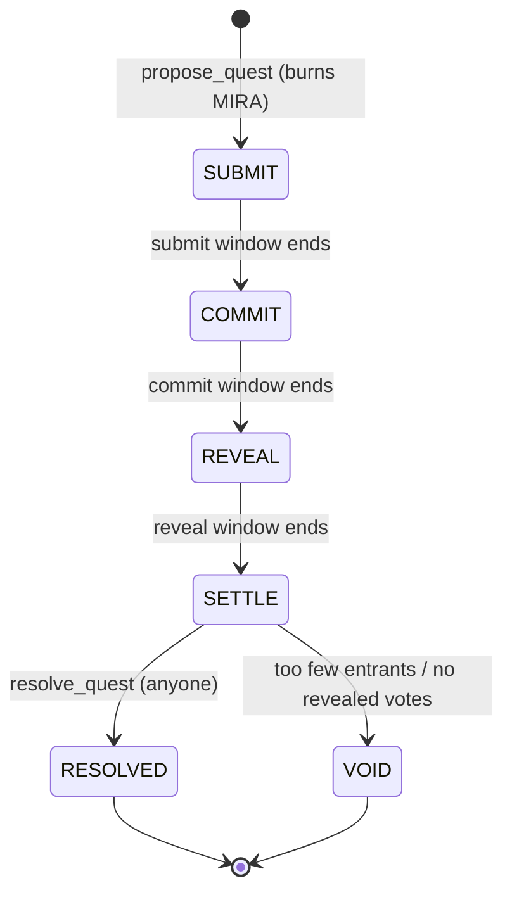
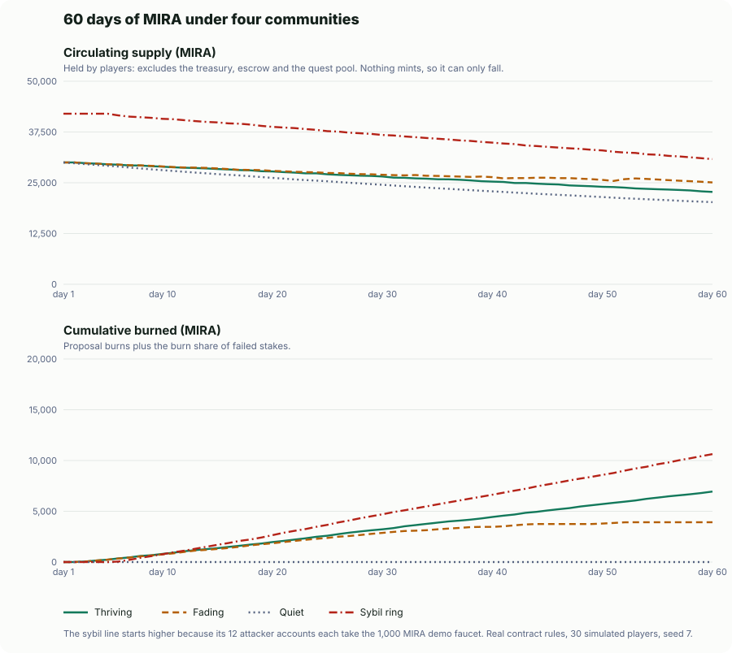

# MIRA — the memecoin that is alive

[](https://github.com/daodudestiny56-netizen/near-memcoin/actions/workflows/ci.yml)


**MIRA is a NEP-141 memecoin whose supply reacts to community activity.** People stake MIRA to enter quests, vote in secret, and watch failed stakes burn on-chain. When the community shows up, MIRA *thrives* and burns harder. When nobody shows up, MIRA *starves*, and anyone can feed it by taxing holders who have gone idle.

> Built for the NEAR Hackathon, track **Memecoins With Mechanics** ("judged on the mechanic, not the chart").

| | |
|---|---|
| **Live app** | [mira-memecoin.vercel.app](https://mira-memecoin.vercel.app) (reads the testnet contract live) |
| **Contract (testnet)** | [`mira-memecoin.testnet`](https://testnet.nearblocks.io/address/mira-memecoin.testnet) |
| **Hardening** | Config locked and **0 access keys** on the contract: [how to check](#7-token-and-trust-model) |
| **Owner / treasury** | [`mira-treasury.testnet`](https://testnet.nearblocks.io/address/mira-treasury.testnet) |
| **Token** | NEP-141, symbol `MIRA`, 18 decimals, 10,000,000 minted once, never again |
| **Source** | this repository (contract, web app, scripts, CI) |
| **Evidence** | [60-day simulation](#6-sixty-days-of-simulation) of the contract's real rule code under four communities, with its findings (including the weaknesses) |
| **Tested wasm** | [`contract/wasm/mira.wasm`](contract/wasm/mira.wasm), built and sandbox-tested by CI from this source |

---

## Contents

1. [The idea in one minute](#1-the-idea-in-one-minute)
2. [Try it in two minutes](#2-try-it-in-two-minutes)
3. [What is real and what is not](#3-what-is-real-and-what-is-not)
4. [The mechanics, in full](#4-the-mechanics-in-full)
5. [A real quest, with real numbers](#5-a-real-quest-with-real-numbers)
6. [Sixty days of simulation](#6-sixty-days-of-simulation)
7. [Token and trust model](#7-token-and-trust-model)
8. [Contract API](#8-contract-api)
9. [Architecture](#9-architecture)
10. [Testing and CI](#10-testing-and-ci)
11. [The web app](#11-the-web-app)
12. [Run it yourself](#12-run-it-yourself)
13. [The testnet deployment](#13-the-testnet-deployment)
14. [Known limitations](#14-known-limitations)
15. [Roadmap](#15-roadmap)
16. [Repository layout](#16-repository-layout)
17. [Related project](#17-related-project)

---

## 1. The idea in one minute

Most memecoins are a ticker. MIRA is a small game whose rules move the supply.

1. **Quests.** A quest is a challenge with a prize pool. Players **stake** MIRA to enter and post **proof** (a link or note).
2. **Secret voting.** Holders **stake to vote** on entries. Votes are hashed (*commit*), then opened later (*reveal*), so nobody can copy the crowd or be swayed by the running tally.
3. **Settlement.** The top third of entries win the pool plus their stake back. Everyone else's stake is **burned, rolled into the next quest, or paid to the voters who backed a winner.**
4. **The heartbeat.** Every join, vote, gm and settlement is a "beat". The number of beats in an epoch sets MIRA's **mood**, and the mood sets how hard failed stakes burn.
5. **Starvation.** If a whole epoch is quiet, MIRA starves. Anyone can then tax long-idle holders 1%: 80% feeds the next quest pool, 20% pays the keeper.

The supply therefore breathes with the community instead of sitting still. Every burn, payout and tax is emitted as an event and appears in the app's live feed.

---

## 2. Try it in two minutes

### Without a wallet (everything an automated check can run)

```bash
git clone https://github.com/daodudestiny56-netizen/near-memcoin && cd near-memcoin

# 1. the rules: 63 unit tests (60 for the game, 3 for the simulation)
cd contract && npm install --ignore-scripts && npm test

# 2. the evidence: re-run the 60-day simulation (deterministic, ~10 s). Rewrites sim/results.json and ../public/simulation.svg
npm run sim

# 3. the web app builds and lints
cd .. && npm install && npm run lint && npm run build

# 4. the live contract answers (supply, burned, mood, quests). The result is a byte array of JSON.
curl -s https://rpc.testnet.fastnear.com -H 'content-type: application/json' -d '{"jsonrpc":"2.0","id":1,"method":"query","params":{"request_type":"call_function","finality":"final","account_id":"mira-memecoin.testnet","method_name":"get_overview","args_base64":"e30="}}'
```

### With a wallet, on testnet

You need a testnet account with a little testnet NEAR for gas. The contract pays storage, and the MIRA itself comes from the faucet.

1. Open [mira-memecoin.vercel.app](https://mira-memecoin.vercel.app) and press **Connect wallet**. Pick a wallet that lists testnet support.
2. **Rituals:** claim the 1,000 test MIRA (once per account), then say **gm**.
3. **Quests:** three quests are parked in different phases for the judging window. Each title starts with "Judges:".
   * **enter this quest** (entries open until 18 Nov 12:41 UTC): stake 10 MIRA and post a proof.
   * **cast a sealed vote** (voting open until 18 Nov 12:44 UTC): stake 2 MIRA and seal a vote for an entry. The salt stays in your browser, so reveal from the same browser once the reveal phase starts.
   * **settle this quest** (reveal window ends 16 Nov 00:45 UTC): votes are already revealed. Once the window ends, press **Settle** and watch the winner payout and the burn arrive in the live feed.
4. Or press **Play a quest** to burn 50 MIRA and propose your own. Phases can be as short as 20 seconds, but a quest needs at least 2 entrants and one revealed vote to settle, so one account cannot finish a quest alone. That is why these are seeded.

If the mascot looks starved, that is the mechanic, not a fault: an epoch on the testnet deployment is 15 minutes, and an epoch with no activity is STARVING. Any action wakes it. The quests were seeded by `scripts/seed-judging.mjs` with the demo accounts, and their entries say so.

### For judges

Where each judging criterion is answered, with the weak spots stated.

| Criterion | Where | The honest caveat |
|---|---|---|
| Technical implementation | The whole game is in the contract, not a server: [`contract/src/core`](contract/src/core) (rules) behind [`contract/src/contract.js`](contract/src/contract.js) (NEP-141 and methods). 63 unit tests and 6 sandbox tests on the real wasm ([section 10](#10-testing-and-ci)), an escrow-conservation test after every settlement path, and CI that builds the wasm and commits the tested binary. The contract has 0 access keys and a locked config ([section 7](#7-token-and-trust-model)). | It is JavaScript on `near-sdk-js`, which is unmaintained and uses more gas than Rust ([section 14](#14-known-limitations)). The rules are isolated in `src/core` so they can be ported. |
| Design | A page whose mascot's face is the contract's mood, with a heartbeat chart, per-phase quest actions and a live feed. Every number is read from the chain. | A transaction signed through a wallet popup has not been exercised by the author ([section 3](#3-what-is-real-and-what-is-not)). |
| Impact | A memecoin whose supply responds to community activity, and a [60-day simulation](#6-sixty-days-of-simulation) of how, including where it fails. | The same simulation shows players end up poorer in every scenario, and a quiet coin parks tokens instead of burning them. MIRA is a sink, not an earner. |
| Originality | Sealed-vote quests combined with a mood-dependent burn split and a starvation tax on idle holders. | I did not do a systematic prior-art search, and other entries in this track also use burns and rules in the contract. |
| Sustainability | Locked config, no keys, anyone can settle a quest or run the starvation keeper. | Nothing runs the keepers automatically yet, and a frozen instance cannot be patched ([section 14](#14-known-limitations)). |

**Against the track's example prompt.** The track's example is a daily check-in streak coin. MIRA is a different mechanic (quests with sealed votes), so it does not implement that example. It answers the example's requirements like this:

| Requirement | Status |
|---|---|
| An NEP-141 token with the mechanic in the contract | Yes. |
| Parameters set at launch, readable by anyone, no admin key able to change them | Mostly. `get_config` is public, the config is locked and the contract has 0 keys. The splits are constants in the code. The owner can still change exemptions and the faucet switch, and the demo values were frozen as they were on 2026-11-10. |
| Sybil resistance good enough for a demo, limits written plainly | Partly. Stakes make sybil voting expensive, and [section 14](#14-known-limitations) and the simulation state the limits. The demo faucet gives every account free MIRA, so on testnet the attack is free. |
| A page with the current state and a log of every mint and burn | Yes: the mood, pulse, supply, burned total and a live feed of every burn, payout and tax. There is no minting, so the log has no mints. |
| Simulate first, then pick the parameters | Yes: [60 days under four communities](#6-sixty-days-of-simulation) and a [parameter sweep](#why-these-defaults). |

---

## 3. What is real and what is not

The README is written so it can be checked against the code.

| Claim | Status |
|---|---|
| The contract is deployed on NEAR testnet at `mira-memecoin.testnet` | **Real.** Verifiable with the views in [section 13](#13-the-testnet-deployment). |
| A full quest has been played on that contract | **Real.** Quest #1 ran propose → join → sealed votes → reveal → settle with five funded testnet accounts ([section 5](#5-a-real-quest-with-real-numbers)). |
| 63 unit tests pass (60 for the game rules and the owner's powers, 3 for the simulation) | **Real.** `cd contract && npm test`, run in CI on every push. |
| The real wasm passes an integration test on a local NEAR chain | **Real.** 6 sandbox tests in CI ([section 10](#10-testing-and-ci)). |
| The web app reads live data from the contract | **Real.** One `get_dashboard` view call every 5 s over plain JSON-RPC, with exponential backoff if the RPC throttles. |
| The web app can sign transactions with a wallet | **Partly verified.** In a real Chrome, the production build opens the NEAR Connector wallet picker with testnet wallets and no console errors. A transaction signed through a wallet popup has **not** been exercised by the author; every contract call has been exercised from scripts with keypairs. A wallet can resolve with a failed outcome instead of rejecting, so the app reads the outcome and shows the contract's panic message rather than a false "confirmed". |
| The supply behaves as described over 60 days | **Simulated, not observed.** The simulation runs the contract's real rule code with random players ([section 6](#6-sixty-days-of-simulation)). The live testnet has had about a day of demo play. |
| The config is locked and the contract has no keys | **Done on testnet and checkable.** `get_overview.config_locked` is `true` and the account has 0 access keys ([section 7](#7-token-and-trust-model) has the one-line check). `lock_config` has unit and sandbox tests. |
| The faucet (`claim`) | **Demo only.** It pays 1,000 test MIRA once per account from the owner's balance. Switch it off with `set_faucet`. |
| Mainnet | **Not deployed.** The contract is unaudited ([section 14](#14-known-limitations)). |

---

## 4. The mechanics, in full

### 4.1 Epochs, pulse and mood

Time is cut into **epochs** (`epoch_s`, 900 s on the testnet deployment, 86,400 s by default). Each state-changing action adds a beat to the current epoch's **pulse**:

| Action | Beats |
|---|---|
| `gm` | 1 |
| `propose_quest` | 1 |
| `join_quest` | 1 |
| `commit_vote` | 1 |
| `reveal_vote` | 1 |
| `resolve_quest` | 1 |

When an epoch ends, its pulse is compared with `target_pulse` and sets the mood used for the next epoch:

| Mood | Rule (pulse vs target `T`) |
|---|---|
| **THRIVING** | pulse ≥ 1.5 × T |
| **STEADY** | T ≤ pulse < 1.5 × T |
| **HUNGRY** | 0.5 × T ≤ pulse < T |
| **STARVING** | pulse < 0.5 × T, **or** any silent epoch in between |

The clock is **lazy**: nothing runs on a timer. The first call after a boundary settles the finished epochs, and an epoch with no activity at all counts as pulse 0 (STARVING). View calls compute the live mood without writing state, so the dashboard is always current.

### 4.2 Where a failed stake goes

Every entrant who does not win loses their stake. That pool of failed stakes is split by the mood at settlement. The splits are **constants in the source code** (`contract/src/core/constants.js`). Nobody, including the owner, can change them after deploy.

| Mood | Burned | Next quest pool | Correct voters |
|---|---|---|---|
| THRIVING | 60% | 20% | 20% |
| STEADY | 50% | 30% | 20% |
| HUNGRY | 35% | 45% | 20% |
| STARVING | 20% | 60% | 20% |

A healthy community burns harder (deflation as a reward for activity). A struggling one feeds the next quest instead, to win people back. Rounding dust always goes to the burn.

### 4.3 Quest lifecycle



* **Propose (burn-to-propose).** The proposer needs a gm streak of at least `propose_streak` and **burns `propose_burn` MIRA** (50 by default). They set the title, the entry stake, an optional seed for the pool, and the three phase lengths. The pool also inherits the whole **rollover** (failed stakes from earlier quests).
* **Enter.** Within the submit window a player stakes `stake` MIRA into contract escrow (one entry per account, up to 30 per quest) and posts a proof of up to 280 characters. Proof can be replaced until the window closes. No proof means no chance to win.
* **Vote (commit).** In the commit window any holder stakes a **vote stake** (`stake / 5`, minimum 1 MIRA) and submits `sha256("{questId}:{voter}:{entrant}:{salt}")`. Binding the voter into the hash means a copied hash cannot be revealed by anyone else.
* **Reveal.** In the reveal window each voter reveals entrant and salt. The contract checks the hash, rejects self-votes, and requires the entrant to have posted proof. Each vote adds **weight 1 + min(scars, 3)** to that entry.
* **Settle.** After the reveal window anyone can call `resolve_quest`.

### 4.4 Settlement rules

* **Winners.** Entries that have proof and at least one vote are ranked by weighted votes (ties go to the earlier joiner). The top `max(1, floor(entrants / 3))` win.
* **Winner payout.** Each winner gets their **stake back plus an equal share of the pool** (pool dust rolls over).
* **Losers.** Every other entrant, including anyone who never posted proof, forfeits their stake and earns a **scar**.
* **Voters.** A vote is *correct* if it was revealed and backed a winner. Correct voters get their vote stake back plus an equal share of the **voter pot**: the voter share of failed stakes **plus the stakes forfeited by wrong and unrevealed voters**. If there are no correct voters the pot is burned.
* **Void.** If a quest has fewer than 2 entrants, or no vote was revealed, it is **voided**: every stake is refunded and the pool rolls over. Nobody loses anything.
* **Conservation.** The contract's balance always equals escrow + pools + rollover. A test asserts this after every settlement path.

### 4.5 Rituals: gm and streaks

`gm` can be called once per epoch. Consecutive epochs build a **streak**; skipping an epoch resets it to 1 (the best streak is kept). A streak of `propose_streak` unlocks proposing quests. Each gm also earns XP and counts as a beat.

### 4.6 Scars

Losing a quest leaves a **scar** on the account. Scars are not tradable. Each scar (up to 3) adds +1 to the account's vote weight. Players who lose and keep playing gain a bit more say.

### 4.7 The starvation keeper

When the mood is STARVING, anyone may call `starve(account_id)` on a holder who:

* has been inactive for at least `starve_idle_epochs` (2) epochs,
* holds at least `starve_min` (10) MIRA,
* has not already been starved this epoch.

The contract takes `starve_bps` (1%) of the balance. **80% moves into the next quest pool and 20% goes to the caller** as a bounty. Active players, the treasury, the contract itself and any account the owner has exempted (for example a DEX pool) are never taxed. This is a deliberate holder cost: MIRA rewards showing up and taxes disappearing.

---

## 5. A real quest, with real numbers

This is quest **#1** on `mira-memecoin.testnet`, played by `scripts/seed.mjs`. Read it back yourself with `get_quest {"id": 1}`. The testnet contract has since been played further (more quests, both burn-heavy THRIVING and burn-light STARVING settlements), so overall totals have grown; quest #1 stays fixed.

| Step | What happened |
|---|---|
| Setup | `mira-ana`, `-bob`, `-cy`, `-dee`, `-eve` each claimed 1,000 test MIRA and said gm. |
| Propose | `mira-ana` burned **50 MIRA** and seeded the pool with **100 MIRA**. Entry stake 25, vote stake 5. |
| Enter | `bob`, `cy`, `dee` each staked 25 and posted proof. |
| Vote | `eve` and `ana` sealed votes (hashes only on-chain). |
| Reveal | Both revealed a vote for `bob`. |
| Settle | The coin was **HUNGRY** (35 / 45 / 20). |

The arithmetic, which the contract's result matches to the last digit:

* Winners: `floor(3 / 3) = 1`, so **bob** wins. He receives his 25 stake back plus the 100 pool: **125 MIRA**.
* Losers: `cy` and `dee` forfeit 25 each, so the failed pool is **50 MIRA**.
* Burned: 35% × 50 = **17.5 MIRA**. Rolled over: 45% × 50 = **22.5 MIRA**. Voter share: 20% × 50 = **10 MIRA**.
* Both voters were correct, so each gets 5 (their stake) + 5 (half of 10) = **10 MIRA**.
* On-chain result: `burned 17.5`, `rolled_over 22.5`, `voter_pot 10`, `correct_voters 2`, `mood HUNGRY`.
* Total burned on the contract after the seed run: 50 + 50 (two proposals) + 17.5 = **117.5 MIRA**.

---

## 6. Sixty days of simulation

The live testnet has had about a day of demo play, so it cannot show how supply behaves over weeks. `contract/sim/` does it the only way available before launch: it drives the **contract's real rule code** (`src/core`, the same functions that run on-chain) with simulated players for 60 days, under four communities. Nothing is re-implemented, and the run throws if the sum of all balances ever differs from total supply.

```bash
cd contract && npm run sim   # deterministic (fixed seed), about 10 s; writes sim/results.json and public/simulation.svg
```



Contract defaults, not the testnet's demo clocks: 1-day epochs, target 20 beats. 30 simulated players each take the faucet and then show up with the scenario's probability. A player who shows up says gm, and with a streak of 3 can propose a quest (burn 50, seed 10, 23 hours long). Others enter, vote and reveal at random, and a keeper bot taxes idle holders whenever the coin is starving. The sybil scenario adds 12 colluding accounts that always enter and vote round-robin for each other.

| Scenario | Days thriving / steady / hungry / starving | Quests settled / void | Burned (MIRA) | Circulating (MIRA) | Quest pool at end | Keeper bounties |
|---|---|---|---|---|---|---|
| Thriving (70% daily) | 57 / 3 / 0 / 0 | 57 / 0 | 6,944 | 30,000 → 22,742 | 0 | 0 |
| Fading (75% → 10%) | 31 / 10 / 5 / 14 | 40 / 1 | 3,922 | 30,000 → 25,078 | 1,000 | 447 |
| Quiet (6% daily) | 0 / 1 / 0 / 59 | 0 / 0 | 0 | 30,000 → 20,217 | 9,783 | 2,446 |
| Sybil ring (50% + 12 colluders) | 55 / 4 / 1 / 0 | 54 / 0 | 10,634 | 42,000 → 30,820 | 0 | 0 |

"Circulating" is what players hold. It excludes the treasury (which holds most of the 10M), escrow and the quest pool, because the burn is tiny against the full supply and only meaningful against what people actually hold. The sybil run starts at 42,000 because its 12 attackers each take the 1,000 MIRA faucet.

**What it shows**

* **Activity sets the burn.** The thriving community burned 6,944 MIRA (2,900 from proposals, 4,044 from failed stakes) and spent 57 of 60 days thriving. The fading one burned 3,922 and drifted through steady and hungry into starving as attendance fell. The quiet one burned nothing.
* **Everyone is a net payer.** Honest players ended 179 to 408 MIRA down (of 1,000) in every scenario; in the quiet one that is the tax alone. MIRA is a sink by design, so there is no free lunch to farm, and also no reason to play for profit. Anyone who needs players to expect a return should not build on this mechanic.
* **A quiet coin is taxed, not burned.** With nobody left to propose a quest, the starvation tax moved about 12,200 MIRA off the players (41% of what they held, in 60 days): 20% to the keeper and 80% into a quest pool that sits unspent. **This is a real weakness of the design**, not a feature. It is on the [roadmap](#15-roadmap).
* **A sybil ring controls outcomes but loses money, at these prize sizes.** Over 8 seeds the 12 colluders won 79 to 86% of all wins from 67% of the entries (a real edge, not a takeover), and still lost 5,100 to 5,600 MIRA, because every losing entry forfeits its stake. Prize pools here are small (a proposer's 10 MIRA seed plus rolled-over stakes). With a large prize the same ring could come out ahead, so this is a cost estimate, not a defence. Part of the ring's edge is probably scar weight (losing builds vote weight up to 4x); the simulation did not isolate that.

### Why these defaults

`npm run sim:sweep` re-runs three communities (thriving, fading, quiet) under nine settings of the two knobs that decide how the coin feels: the beat target and the starvation tax. Same seed, same 30 players, 60 days.

| Beat target | Tax | Thriving: burned (days thriving) | Fading: burned (days starving) | Quiet: pool parked / honest net each |
|---|---|---|---|---|
| 10 | 0.5% | 6,944 (59) | 3,982 (3) | 5,449 / -227 |
| 10 | 1% | 6,944 (59) | 3,982 (3) | 9,678 / -403 |
| 10 | 2% | 6,944 (59) | 3,982 (3) | 15,491 / -646 |
| **20** | 0.5% | 6,944 (57) | 3,922 (14) | 5,517 / -230 |
| **20** | **1%** | 6,944 (57) | 3,922 (14) | 9,783 / -408 |
| **20** | 2% | 6,944 (57) | 3,922 (14) | 15,616 / -651 |
| 40 | 0.5% | 6,584 (23) | 3,489 (19) | 5,517 / -230 |
| 40 | 1% | 6,584 (23) | 3,489 (19) | 9,783 / -408 |
| 40 | 2% | 6,584 (23) | 3,489 (19) | 15,616 / -651 |

* **The beat target decides whether mood means anything.** At 10, this community is "thriving" 59 days of 60 and the fading one starves for only 3, so the mood never bites. At 40, even the thriving community is thriving only 23 days. The default of 20 (about two thirds of a player per day for 30 players) separates the scenarios: 57 thriving days against 14 starving days in the fading run. The target has to scale with the community, which is why it is a launch parameter.
* **The tax only costs idle holders.** It does not change what thriving or fading communities burn, and doubling it doubles what the quiet community loses and parks. The default of 1% is a compromise, and 0.5% would hurt a quiet community half as much. Because it fixes nothing by itself, the real fix is the unspent-pool problem above.
* **The testnet deployment uses different values** (a target of 10 and 15-minute epochs) because only a handful of demo accounts play there. The sweep is about the contract's defaults.

**Limits of the simulation.** Players are random and do not adapt, there is no market or price, one keeper bot is always on, and gas is not modeled. The numbers show how the rules respond to activity, not what a real community would do. Seed 7 is shown; the other seeds I ran agree within a few percent (thriving burned 6,800 to 7,112, quiet pool 9,691 to 9,920).

---

## 7. Token and trust model

* **Standard.** NEP-141 (`ft_transfer`, `ft_transfer_call`, `ft_balance_of`, `ft_total_supply`, `ft_metadata`) with NEP-141 events, plus no-op NEP-145 storage methods so wallets and DEXs can register accounts without a deposit (the contract pays storage).
* **Supply.** 10,000,000 MIRA minted **once** at `init`, to the owner. There is no mint function. The only thing that changes supply is burning.
* **Burn sources.** Quest proposals (50 MIRA each) and the burn share of failed stakes.

What the **owner** can and cannot do:

| Can | Cannot |
|---|---|
| Tune clocks and thresholds (`set_config`): `epoch_s`, `target_pulse`, `min_phase_s`, `propose_streak`, `propose_burn`, `starve_bps`, `starve_min`, `starve_idle_epochs`, `claim_amount` | Mint tokens |
| **Freeze that config for good** (`lock_config`, one-way) | Pause or freeze anything |
| Exempt an account from starvation (`set_exempt`) | Touch escrow, pools or rollover |
| Switch the demo faucet on or off (`set_faucet`) | Change the burn / rollover / voter splits (constants in the code) |
| | Change winner rules, or settle a quest differently than the code says |
| | **After `lock_config`:** change any tunable value again. Nobody can, and there is no unlock. |

**Locking.** `lock_config` makes the clocks and thresholds permanent and emits a `CONFIG_LOCKED` event carrying the final values; `get_overview.config_locked` and the web page show the state. A contract can also be launched already locked (`init {…, lock_config: true}`). Locking does not touch `set_exempt` or `set_faucet`: exemptions are needed for DEX pools and the faucet is a demo switch, and neither can change a rule or move escrow.

**The testnet deployment is locked and keyless** (done on 2026-11-10 with `scripts/make-keyless.mjs`, which refuses to delete the key unless the lock is proven first):

* **Config locked.** `config_locked` is `true`; the `CONFIG_LOCKED` event is in the contract's feed and `set_config` is rejected, even for the owner. The demo values it froze: 15-minute epochs, target 10 beats, 20-second minimum phases, a gm streak of 1 to propose.
* **0 access keys.** `mira-memecoin.testnet` has no keys, so nobody (including the author) can sign as it, replace its code, or upgrade it. Check it yourself: `curl -s https://rpc.testnet.fastnear.com -H 'content-type: application/json' -d '{"jsonrpc":"2.0","id":1,"method":"query","params":{"request_type":"view_access_key_list","finality":"final","account_id":"mira-memecoin.testnet"}}'` returns `"keys":[]`. The web page reads the same count live (section 7 of the page, "No keys").
* **What the owner (`mira-treasury.testnet`) can still do:** `set_exempt`, `set_faucet`, and move the treasury's tokens like any holder. The treasury holds the unissued supply and also funds the faucet, so it can drain the faucet. None of that changes a rule or touches escrow.
* **The price of being keyless.** A bug found now cannot be fixed on this instance. A fix means a new instance with a new account name.

Note that the treasury account *does* hold the unissued supply, and the owner can move it like any holder. A production launch would put the treasury under a DAO or multisig.

---

## 8. Contract API

All amounts are decimal strings in base units (18 decimals). Account IDs are strings.

### Token (NEP-141 / NEP-145)

| Method | Type | Notes |
|---|---|---|
| `ft_transfer {receiver_id, amount, memo?}` | call | Requires exactly 1 yoctoNEAR. |
| `ft_transfer_call {receiver_id, amount, memo?, msg}` | call | 1 yoctoNEAR. If the receiver fails or returns unused tokens, they are refunded. |
| `ft_balance_of {account_id}` · `ft_total_supply` · `ft_metadata` | view | |
| `storage_deposit` · `storage_balance_of` · `storage_balance_bounds` | | No-ops: accounts need no registration. |

### Game

| Method | Who | What |
|---|---|---|
| `gm` | anyone | Once per epoch. Builds the streak. |
| `claim` | anyone | Demo faucet, once per account. |
| `propose_quest {title, description, stake, seed?, submit_s, commit_s, reveal_s}` | streak holder | Burns `propose_burn`, returns the quest id. |
| `join_quest {id}` | anyone | Stakes into escrow. |
| `submit_proof {id, proof}` | entrant | Until the submit window closes. |
| `commit_vote {id, commit}` | anyone | `commit` = lowercase hex SHA-256 of `"{id}:{voter}:{entrant}:{salt}"`. |
| `reveal_vote {id, entrant, salt}` | voter | In the reveal window. |
| `resolve_quest {id}` | anyone | After the reveal window. |
| `starve {account_id}` | anyone | Only while STARVING. |

### Owner

`set_config {config}` (fails once locked) · `lock_config` (one-way, owner only) · `set_exempt {account_id, exempt}` · `set_faucet {on}`. `init` also accepts `lock_config: true`.

### Views

`get_overview` (supply, burned, rollover, treasury, circulating, mood, pulse, history, current splits, `config_locked`) · `get_config` · `get_dashboard {account_id?, quest_limit?, event_limit?, board_limit?}` (everything the page shows in one call) · `list_quests {from_id, limit}` (newest first) · `get_quest {id}` (entries and who has voted or revealed, never the choice) · `get_player {account_id}` · `get_leaderboard {limit}` · `recent_events {limit}`

---

## 9. Architecture

```
┌────────────────────────┐        one get_dashboard view / 5 s          ┌──────────────────────────┐
│  React + Vite web app  │ ───────────────────────────────────────▶ │  mira-memecoin.testnet   │
│  (src/)                │                                          │  near-sdk-js wrapper     │
│  @hot-labs/near-connect│ ── signed FunctionCall via wallet ─────▶ │  └─ src/core (game rules)│
└────────────────────────┘                                          └──────────────────────────┘
```

**Why the rules are separate from the contract.** `near-sdk-js` does not install on Windows ("Platform win32 is not supported"), so the whole game lives in plain ES modules under `contract/src/core/`. They talk to storage through a tiny `get / set / del` interface and take the host (`sha256`, `log`) as injected dependencies. That has three effects:

* The same code runs in Node (fast unit tests anywhere) and on-chain.
* `contract/src/contract.js` is only a thin shell: decorators, argument parsing, NEP-141 promises.
* CI on Linux compiles the shell with `near-sdk-js` and tests the real wasm.

| Module | Responsibility |
|---|---|
| `core/game.js` | Per-transaction context, typed storage helpers, the event ring buffer. |
| `core/token.js` | Balances, transfers, burns, `ft_transfer_call` refund math. |
| `core/heartbeat.js` | Epochs, pulse, mood (pure functions, view-safe). |
| `core/players.js` | Stats, gm streaks, scars, faucet, leaderboard. |
| `core/quests.js` | Propose, join, proof, quest listing. |
| `core/settle.js` | Commit, reveal, settlement and payout. |
| `core/starve.js` | The starvation keeper. |
| `core/views.js` | Read-only aggregates for the dashboard. |
| `core/admin.js` | Init and the owner's narrow powers. |
| `core/constants.js` | Splits, defaults, caps. |

**Storage layout.** Per-key records instead of one big blob: `m` (meta), `cfg`, `hb` (heartbeat), `b:{account}` (balance), `s:{account}` (stats), `q:{id}`, `qe:{id}:{account}` (entry), `qv:{id}:{account}` (vote), `ev:{n}` (event ring of the last 100). Amounts are stored as BigInt-safe JSON.

---

## 10. Testing and CI

**63 unit tests** (`cd contract && npm test`, Node's built-in runner): 60 cover the rules and 3 cover the simulation.

* token: supply, overdrafts, burn accounting, `ft_transfer_call` refund math
* heartbeat: thresholds, epoch rollover, silent-epoch starvation, view-without-write
* players: streaks, resets, once-per-epoch, faucet, leaderboard
* quests: propose, escrow, seeds and rollover inheritance, validation, deadlines
* settlement: happy path, wrong and unrevealed voters, void paths, copied commits, self-votes, double settlement, mood-dependent splits, and an **escrow conservation** check after each path
* starvation: eligibility, once-per-epoch, exemptions, dust, owner-only controls
* owner powers: tuning until locked, owner-only and one-way `lock_config`, launching locked, and that the lock leaves the other owner powers as they were
* simulation: every scenario runs and conserves supply, a fixed seed gives identical output, and a thriving community burns more than a quiet one

**6 sandbox tests** (`npm run test:sandbox`, near-workspaces) deploy the built `mira.wasm` to a local NEAR chain and exercise the real contract: NEP-141 metadata and supply, the 1-yocto requirement, a failing `ft_transfer_call` that refunds everything, the faucet, an entire quest through to the burn, and freezing the config for good.

**CI** (`.github/workflows/ci.yml`) runs two jobs on every push. The *contract* job runs unit tests → builds the wasm → runs the sandbox tests → commits the tested wasm to `contract/wasm/`. The *web* job installs, lints, type-checks and builds the app.

**Bugs the tests caught (and I fixed).** These are in the git history:

* *Views read the caller.* NEAR forbids `predecessor_account_id` and `attached_deposit` inside view calls. Every view would have failed on-chain while every unit test passed. The sandbox test found it.
* *Imports shadowing methods.* `near-sdk-js` hoists each method to a top-level function, so imports named `init`, `gm`, `claim` and `starve` produced "Duplicate declaration". CI's build step found it.
* *A stale UI under rate limiting.* While filming the demo, the page was making ~13 RPC calls per refresh and the public RPC throttled it, so the screen lagged the chain. Fixed with the single `get_dashboard` view, polling backoff, and a sandbox assertion on that view. The deprecated `rpc.testnet.near.org` (it now answers 429 on purpose) was removed from the app and scripts at the same time.
* *`list_quests` returned the oldest quests*, not the newest, once there were more than one page. A unit test now covers it.

---

## 11. The web app

React 19 + TypeScript + Vite, Bricolage Grotesque, no UI library.

* **Hero.** A mascot whose *face is the contract's mood*: its expression changes, and it breathes faster as the pulse approaches the target. Live supply, burned, circulating, rollover pool and a countdown to the next heartbeat.
* **Vitals.** A heartbeat chart of pulse per epoch against the target, and a bar showing exactly where a failed stake goes under the current mood. A **mood picker** previews all four moods (mascot face, effect, burn / rollover / voter split) without touching the chain; it is labelled as a preview.
* **Quests.** Cards with a four-step timeline and a per-phase action: enter, proof, sealed vote (the salt stays in this browser's local storage), reveal, settle. A burn-to-propose dialog.
* **Rituals.** gm with a streak counter, scars, the faucet, and the starvation keeper.
* **Live feed**, **leaderboard**, the **60-day simulation** chart with its findings, and an honest "how it works / limits" section that shows whether the config is locked.

Data flow: `src/chain/rpc.ts` calls the contract's views over JSON-RPC (two FastNEAR endpoints, tried in turn); `src/state/mira.tsx` polls `get_dashboard` once every 5 s (doubling the wait up to 8x after a throttled response) and holds state; transactions go through `src/chain/wallet.ts`, which reads the outcome the wallet returns (`src/chain/outcome.ts`) and surfaces the contract's panic message if the call failed. A `VITE_MOCK=1` fake chain exists for UI development only and is not bundled into production builds.

---

## 12. Run it yourself

Requirements: Node 20+ (22+ for the web app build).

```bash
# web app against the live testnet contract
npm install
npm run dev            # http://localhost:5173
npm run build && npm run lint

# unit tests for the game rules (any OS), and the 60-day simulation
cd contract && npm install --ignore-scripts && npm test
npm run sim            # rewrites sim/results.json and ../public/simulation.svg
npm run sim:sweep      # parameter sweep: beat target x starvation tax
```

`npm install` inside `contract/` runs a `near-sdk-js` post-install that fails on Windows; use `--ignore-scripts` there. Building the wasm and running sandbox tests needs Linux (or WSL), which is what CI does:

```bash
cd contract && npm install && npm run build && npm run test:sandbox
```

### Recording the demo (and why there is a test signer)

A headless browser cannot operate a wallet popup, so the demo is filmed with a **recording-only signer**:
`VITE_DEMO_SIGNER=1` makes the page hand each transaction to a harness (`scripts/demo/record.mjs`) that signs it in Node with throwaway testnet keys. The harness drives the *real* UI (visible cursor, real clicks and typing), and every action is a real testnet transaction. The checks are literal `import.meta.env` comparisons, so normal and production builds contain none of this code (the live bundle was checked for it).

```bash
VITE_DEMO_SIGNER=1 npx vite build --outDir dist-demo
npx vite preview --outDir dist-demo --port 5200 &
cd scripts/demo && npm install && node record.mjs out/   # needs the demo accounts' keys in ~/.near-credentials
```

Environment variables (`.env`): `VITE_MIRA_CONTRACT` (contract account), `VITE_NEAR_NETWORK` (`testnet` | `mainnet`), `VITE_NEAR_RPC` (comma-separated RPC URLs), `VITE_MOCK=1` (UI development only).

---

## 13. The testnet deployment

Deployed with `scripts/deploy.mjs` from the CI-tested wasm (566 KB). Initialised with demo clocks:

```json
{ "owner_id": "mira-treasury.testnet", "faucet_on": true,
  "config": { "epoch_s": 900, "target_pulse": 10, "min_phase_s": 20, "propose_streak": 1 } }
```

Verify it yourself without any tooling (replace the method and args as needed):

```bash
curl -s https://rpc.testnet.fastnear.com -H 'content-type: application/json' -d '{
  "jsonrpc":"2.0","id":1,"method":"query","params":{
    "request_type":"call_function","finality":"final",
    "account_id":"mira-memecoin.testnet","method_name":"get_overview",
    "args_base64":"e30="}}'
# the result is a byte array of JSON; decode it, or use the web app / near-cli
```

Scripts (in `scripts/`, own `package.json` with `near-api-js`):

| Script | Purpose |
|---|---|
| `create-testnet-account.mjs` | Create a faucet-funded testnet account. Keys are written to `~/.near-credentials/`, never to the repo. |
| `deploy.mjs` | Check storage cost, deploy `contract/wasm/mira.wasm`, initialise, verify. |
| `seed.mjs` | Play a full quest with five accounts, then leave a second quest open. |
| `make-keyless.mjs` | One-way hardening, needs `--yes`: top up storage, `lock_config`, prove `set_config` is rejected, then delete the contract's only access key. Already run on testnet. |
| `seed-judging.mjs` | Leave three quests parked in the enter, vote and settle phases for the judging window (entries say they are seeded demo content). |

---

## 14. Known limitations

Hackathon software, stated plainly:

* **Unaudited, testnet only.** Do not put real value in it.
* **Sybil votes.** One account is one vote (plus scar weight). Someone with many funded accounts can sway a quest. Stakes make it expensive, not impossible. In the [simulation](#6-sixty-days-of-simulation) a 12-account ring took about 80% of wins from 67% of entries and still lost money at small prize sizes, but a large prize would change that arithmetic. The demo faucet also hands every new account 1,000 free MIRA, so on testnet the attack is free; a mainnet launch has no faucet and sybils would have to buy their tokens. Mitigations on the roadmap: stake-weighted or reputation-gated voting.
* **Collusion between voters and entrants** is not prevented beyond the self-vote rule.
* **Entry and voter caps** (30 entrants, 60 voters per quest) keep settlement inside the gas limit of a JS contract.
* **Free actions cost the contract storage.** The contract pays storage for stats and entries, so a spammer could burn its storage balance. A production version needs a storage deposit or a fee.
* **`near-sdk-js` is unmaintained** (last release June 2024) and NEAR's docs call `near-sdk-rs` the only official SDK. JS contracts also use more gas than Rust. The rules are isolated in `src/core` precisely so they can be ported.
* **A transaction signed through a wallet popup has not been exercised** by the author (see [section 3](#3-what-is-real-and-what-is-not)). The wallet picker opens in Chrome, and reads and every contract call from scripts are verified.
* **The testnet instance is frozen.** Its config is locked and it has no access keys, so a bug cannot be patched there; the demo clocks (15-minute epochs) are permanent, and a fix needs a new instance. The owner can still change exemptions and the faucet switch, and it holds the treasury.
* **A quiet coin parks tokens instead of burning them.** When nobody is left to propose a quest, the starvation tax fills a quest pool that nothing spends (about 9,800 MIRA after 60 quiet days in the simulation), and the keeper takes 20%.
* **`ft_transfer_call` is tested against a failing receiver**, not a real DEX receiver.
* **The starvation tax is a real cost to idle holders**, by design. Exempt DEX pools and treasuries with `set_exempt`.
* **The leaderboard indexes the first 1,000 players** and sorts on read, and `get_dashboard` includes it, so a very large player base would need an indexer or a capped top-N stored on write.
* **Free public RPCs throttle.** The app backs off, but heavy traffic needs a dedicated RPC key (`VITE_NEAR_RPC`).
* **Timing uses the block timestamp**, which is set by validators within a small tolerance.
* **Local vote salts.** A sealed vote can only be revealed from the browser that sealed it unless the user saved the salt.

---

## 15. Roadmap

* Port `src/core` to `near-sdk-rs`, keeping the test vectors.
* Stake-weighted or reputation-gated voting to harden against sybils.
* Treasury under a DAO (Sputnik) instead of an EOA.
* NEAR Intents integration so MIRA can be swapped and bridged.
* Automated keepers for `resolve_quest` and `starve`.
* A way out for an unspent quest pool in a long quiet spell (for example, burn it after N idle epochs, or let any holder seed a quest from it), found by the simulation.
* Mainnet launch after an audit.

---

## 16. Repository layout

```
.
├── contract/
│   ├── src/core/          game rules (plain ES modules, unit-tested)
│   ├── src/contract.js    near-sdk-js wrapper: NEP-141 + game methods
│   ├── test/              63 unit tests
│   ├── sandbox/           6 integration tests against the real wasm
│   ├── sim/               60-day simulation that drives the real rules (npm run sim)
│   └── wasm/mira.wasm     CI-built, sandbox-tested binary
├── src/                   React web app (chain/, state/, ui/)
├── public/simulation.svg  the simulation chart (generated)
├── scripts/               account creation, deploy, seed, seed-judging, demo-quest
│   └── demo/              Playwright recorder for the walkthrough video
├── .github/workflows/     CI
└── README.md
```

### Libraries, licence and provenance

* **Licence:** [MIT](LICENSE).
* **Written during the hackathon.** The first commit in this repository is dated 2026-11-09; `git log` shows the whole history.
* **Contract:** `near-sdk-js` 2.0.0 (NEAR's JS SDK, used for the wasm wrapper only); tests use Node's built-in runner, `ava` and `near-workspaces`.
* **Web app:** React 19, Vite, TypeScript, `oxlint`, and `@hot-labs/near-connect` for wallet connection. Font: Bricolage Grotesque.
* **Scripts:** `near-api-js` (deploy and seed), `playwright-core` (demo recorder only).
* **Not used in the contract:** no third-party game or token template. The game rules in `contract/src/core` and the simulation in `contract/sim` are original to this repository.

---

## 17. Related project

Disclosed per the hackathon rules (each README names the other): the author is also submitting **[NEAR Agent Census](https://github.com/daodudestiny56-netizen/near-thesis-)** in the **Investment Thesis** track. It is a re-runnable census that classifies NEAR activity as human-like or automated from on-chain behaviour and measures the automated share of transactions and fees over time. It is its own entry; MIRA is the Memecoins With Mechanics entry. The two share no code.
